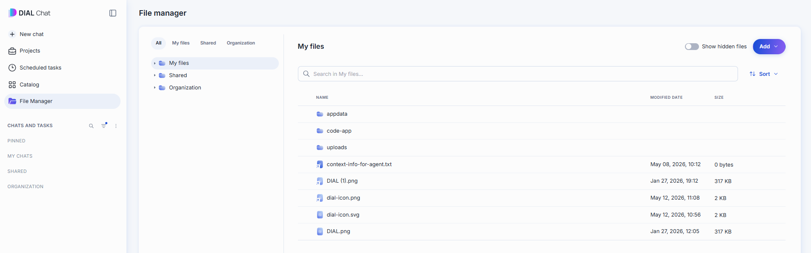
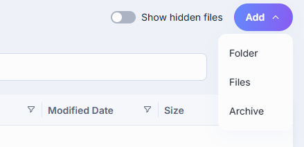
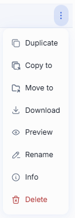

# File Manager

The File Manager is where everything you upload or receive in DIAL Chat is stored: your own files, the attachments you added to conversations, files other people shared with you, and files available to your whole organization. Click **File Manager** in the sidebar.

On the left are the tabs and the folder tree. On the right is the open folder, with its path above the list, a search box, **Sort**, a **Show hidden files** toggle, and the **Add** button.

## Tabs

| Tab | What it holds | What you can do | Sharing and publishing |
|---|---|---|---|
| **All** | The default view: **My files**, **Shared**, and **Organization** as three top-level folders in one tree. | Whatever the folder you open allows. | — |
| **My files** | Your own files and folders: uploads, conversation attachments, and voice recordings. Private to you. | Everything: add, organize, rename, download, delete. See [Work in My files](#work-in-my-files). | Sharing a conversation also shares the files attached to it, as long as they're in your storage. Publishing a conversation doesn't publish its attachments. |
| **Shared** | Files and folders other people shared with you, including the attachments of a conversation someone shared with you. | **Download**, and **Unshare** to remove an item from your list. DIAL Chat asks "Remove from My List?" first. Afterwards the item is no longer available to you, and in any conversation that refers to it, it is shown as not supported. The file stays with whoever shared it. You can't rename, move, or delete what you didn't create. | Sharing an agent shares the agent and the prompts its skills use, but not its source files, context files, or toolsets — so those files don't appear here. |
| **Organization** | Files stored for your whole organization. What's there depends on your organization. See [Authentication and access control](../2.understand-dial/4.security-and-governance/1.authentication-and-access-control.md) for how private and public storage differ. | **Download** and **Info** only. | Publishing submits only the item itself, so attachments don't come along. |

**Note**
> Your administrator can limit which tabs appear. You can't copy or move items between My files, Shared, and Organization.

## How files get into My files

- **Attachments.** A file you attach to a message is uploaded the moment you add it, not when you send the message. It's stored under `uploads/<year-month>`, so you can attach it to another conversation later without uploading it again. See [Attachments](./1.conversations.md#attachments) in Conversations.
- **Voice recordings.** Audio you attach, and recordings you dictate, go to the same `uploads/<year-month>` folder and stay there after the message is sent. They appear as `voice-<id>.weba` files.
- **Direct uploads.** Files you add in the File Manager itself, and files you pick or upload when you edit an app, skill, or toolset.
- **Files created by applications.** An application or agent can return files in its replies. Whether such a file is also kept in your storage depends on the application.

## Work in My files

### Find a file

Type in the search box to look for files by name. Search covers the whole tab you're in, not only the open folder. **Sort** changes the order of the list.

### Add a file or folder

Click **Add** for three options. Uploads and archives run in a queue that shows each file with its progress, for example **Uploading 2 files**. You can cancel a file while it is in progress:

- **Folder** — creates a folder in the current location.
- **Files** — uploads one or more files from your device.
- **Archive** — uploads a `.zip` and extracts it into a new folder, instead of leaving the archive itself as a file.

When a file with the same name already exists in the folder, DIAL Chat asks **Replace or Duplicate Item**. For several files, choose **Replace all**, **Duplicate all**, or **Decide for each**. A file that is over the size limit is not uploaded, and the message tells you the maximum size. If an archive contains items that cannot be uploaded, the message lists them, and the rest are uploaded.

**Note**
> File and folder names cannot contain these characters: tab, `"`, `:`, `;`, `/`, `\`, `,`, `=`, `{`, `}`, `%`, `&`. If you type one, the File Manager shows a message and does not save the name.

### File and folder actions

Open a file or folder's **···** menu for the actions available on it:

- **Duplicate** — makes a copy in the same location.
- **Copy to** / **Move to** — copy or move it to another folder in your private space, picked from a folder browser. In the browser, **Add folder** creates a new folder. You cannot move a folder into itself or its subfolders, and the original location is unavailable as a target. A queue shows copy and move progress.
- **Download** — downloads it to your device. A queue shows **Preparing download…** and its progress.
- **Delete** — asks you to confirm. Deleting is permanent and cannot be undone.
- **Rename** — changes the name in place. A name cannot be empty, cannot be longer than 255 characters, cannot contain consecutive dots, and cannot match a reserved name or another item in the same folder. A name that starts with a dot hides the item, and DIAL Chat warns you.
- **Info** — a read-only panel with name, modified date, size, author, and full path. Only files show this; folders don't.
- **Remove access** — appears once the file has been shared with someone and they've opened it (typically because it was attached to a shared conversation). Cuts off their access to this one file without touching the conversation it came from.

Select the check boxes next to several items to act on them together: delete, copy, move, duplicate, or remove from your list. The File Manager shows how many items are selected, and the dialogs for several items, such as delete, name how many are affected.

**Note**
> Some applications can be configured to attach an entire folder to a conversation. Only folders you created in the File Manager — not folders that appear only inside a conversation's attachments — can be attached this way.

### Hidden files

Turn on **Show hidden files** to reveal items whose name starts with a dot. These are system files rather than content you'd open. For example, creating a folder also creates an empty `.dial_folder` marker inside it, which is what makes an otherwise-empty folder exist in storage. Leave the toggle off day to day; turn it on only to confirm one of these markers is there, or to find a file you uploaded with a leading dot in its name.

## Next steps

- [Conversations](./1.conversations.md#attachments) — attach a file to a message
- [Sharing and publishing](./5.sharing-and-publishing.md) — how files travel with shared and published items
- [Catalog](./3.catalog/0.index.md) — build a Quick App that uses files as context
