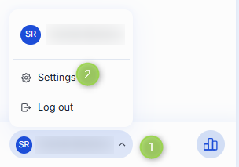
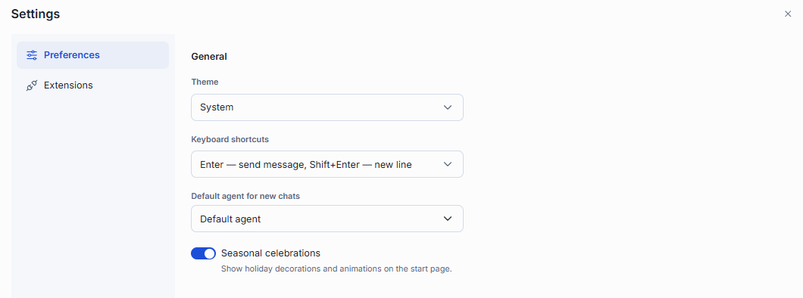
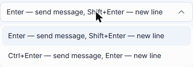
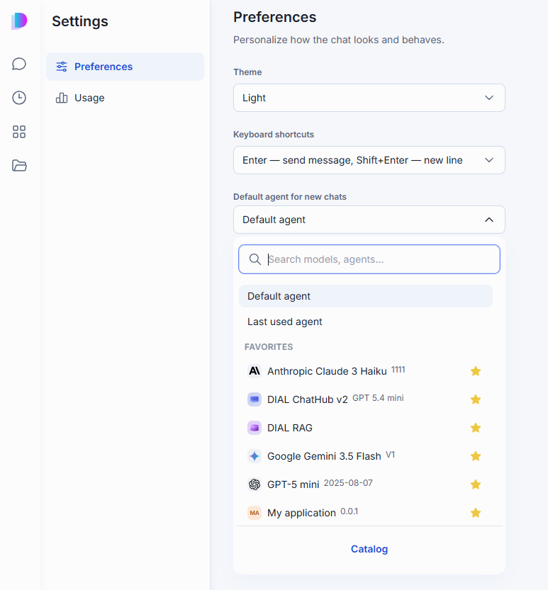
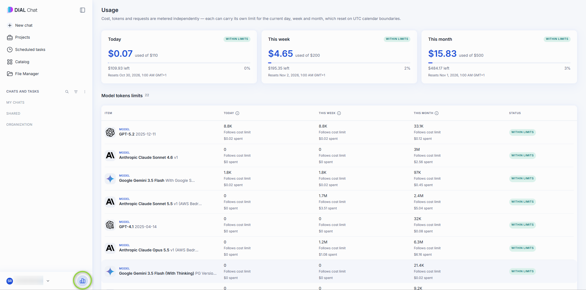
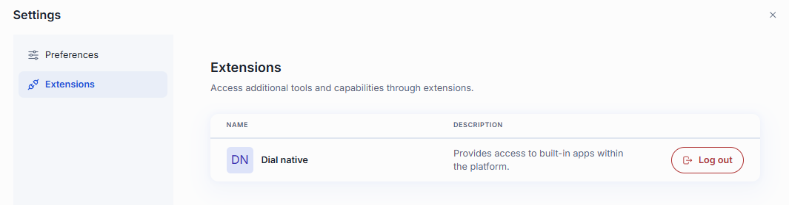
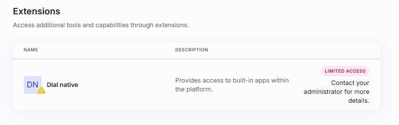

# Usage and settings

Your personal settings and usage numbers are separate from the Catalog and the File Manager. Both are in the bottom-left corner of the sidebar:

1. Click your name to open the user menu, then click **Settings**.
2. Click the bar-chart icon next to your name to open **Usage**.

**Settings** has up to two tabs: **Preferences**, where you set how the chat behaves for you, and **Extensions**, where you manage the sign-in that lets scheduled tasks run while you are away. **Usage** is a separate page, where you see what you've spent against your limits.

## Preferences

The Preferences tab has three settings: **Theme**, **Keyboard shortcuts**, and **Default agent for new chats**. A **Seasonal celebrations** switch appears below them when your deployment runs a seasonal event.

**Theme** sets the chat's color scheme:

- **Light** and **Dark** — the schemes your deployment ships. (A deployment can add its own themes, which appear in the list too.)
- **System** — follows your operating system's light or dark setting and switches with it. This option appears only when your deployment offers both a Light and a Dark theme.

Your choice is remembered in the current browser. If you've never picked one, the chat starts in Light.

**Keyboard shortcuts** decides what Enter does in the composer:

- **Enter — send message, Shift+Enter — new line** (the default)
- **Ctrl+Enter — send message, Enter — new line** — pick this if you write multi-line messages often and don't want to hold Shift every time. On macOS the modifier is ⌘ instead of Ctrl.

**Default agent for new chats** decides which agent a brand-new conversation opens with:

- **Default agent** — your deployment's standard agent.
- **Last used agent** — whichever agent you talked to most recently, in any conversation.
- Any specific model or agent — search for it, or pick from your Catalog favorites shown directly in the list. Click **Catalog** at the bottom to browse further.

This only sets the starting point for a **new** conversation. You can still switch agents before or during any conversation — see [Choose and change the agent](./1.conversations.md#select-an-agent).

**Seasonal celebrations** turns the holiday decorations and animations on the start page on or off. The switch appears only while your deployment has a seasonal event enabled. Your choice is remembered in the current browser. Until you make one, the deployment's default applies.

## Usage

The Usage page shows what you've used against the limits your administrator set, for three periods: **Today**, **This week**, and **This month**. These are calendar periods, not rolling windows — each card shows when its period resets, so a new day doesn't reset your weekly or monthly totals.

The three cards at the top show your overall cost against your overall cost limit for each period, with how much is left and a status badge:

- **Within limits** — you're under the limit.
- **Running low** — you're close to the limit.
- **Limit reached** — the limit is used up. While a period's overall cost limit is reached, you can't use any model until that period resets, no matter how many tokens you have left.

**Model tokens limits** breaks usage down per item for the same three periods, in an **Item / Cost / Tokens / Status** table. It lists the models and agents you've used — an agent's cost includes the models it called. Each row carries the same three status badges, and shows whether that item **Follows cost limit** or has **No limit** for the period.

**Note**
> Cost, tokens, and requests are metered independently, and each can carry its own limit. A model can be within its token limit while over its cost limit, or the reverse. Check with your administrator how the limits for your account were set.

### Usage in a conversation

Your administrator can show your usage next to the message composer, so you see it while you chat:

- **Usage dial** — a small gauge beside the composer. It shows the share of the limit that is closest to running out for the selected agent, and its color changes as you approach the limit. Click it to open a popover titled with the agent's name. The popover lists the agent's **Token limits** and the **Cost limits** for all agents, for each period. Click **See all usage** to open the Usage page. The dial is available only when your administrator turns it on.
- **Warning banner** — a notice above the composer when you are close to a limit, for example "Daily limit 80% used." It appears at 75% by default, and your administrator can change that. When a limit is used up, the notice reads, for example, "Daily limit reached." Click the close icon to dismiss it. The banner shows while the usage dial is off.

**Note**
> Your administrator can hide the Usage page. The **See all usage** link and the bar-chart icon then disappear.

## Extensions

The **Extensions** tab in Settings appears when scheduled tasks are enabled in your deployment. It lists the services DIAL Chat uses to act for you while you are away. Today it has one row, **Dial native**, with its **Name**, a **Description**, and an action.

**Dial native** is your own DIAL account, connected for offline access. When you log in, you let DIAL act on your behalf without you being present, which is what lets a [scheduled task](./2.scheduled-tasks.md) run at its scheduled time. The row's description reads "Provides access to built-in apps within the platform."

Logging in is not enough on its own. An administrator must also approve this access for the whole organization, once.

- **Log in** — shown when you are signed out. It opens a sign-in window, so allow pop-ups for DIAL Chat if your browser blocks it.
- **Log out** — shown when you are signed in. DIAL Chat asks you to confirm, because you lose access to the built-in apps until you log back in, and your scheduled tasks no longer run automatically. After you log out, the row may show **Limited access** instead of **Log in**.
- **Limited access** — a red badge shown instead of the buttons when the approval for scheduled tasks is missing. It can appear after you log out. Log in again. If the badge stays, contact your administrator. You can't create, edit, or run scheduled tasks until an administrator restores it, and logging in does not help. Contact your administrator.

## Next steps

- [Conversations](./1.conversations.md#select-an-agent) — switch agents within a conversation
- [Catalog](./3.catalog/0.index.md) — find and favorite the agent you want as your default
